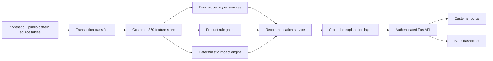

# Architecture

Responsibilities are intentionally separated:

- ML categorises transactions and predicts take-up propensity/confidence.
- Product rules suppress opportunities ruled out by known data.
- The impact engine alone calculates sustainability estimates.
- The LLM/template can only explain a structured payload and cannot alter it.
- FastAPI enforces that a customer can request only their own record; a bank
  role can open the portfolio and authorised customer drill-down.
- Streamlit displays API results and never makes an eligibility decision.

The offline pipeline is reproducible with seed 42. Runtime scoring loads the
saved model artifacts and executes model inference, gates and impact calculation
for a requested customer. Portfolio analytics use the reproducible batch output.
